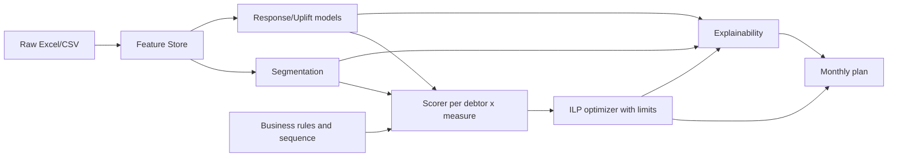
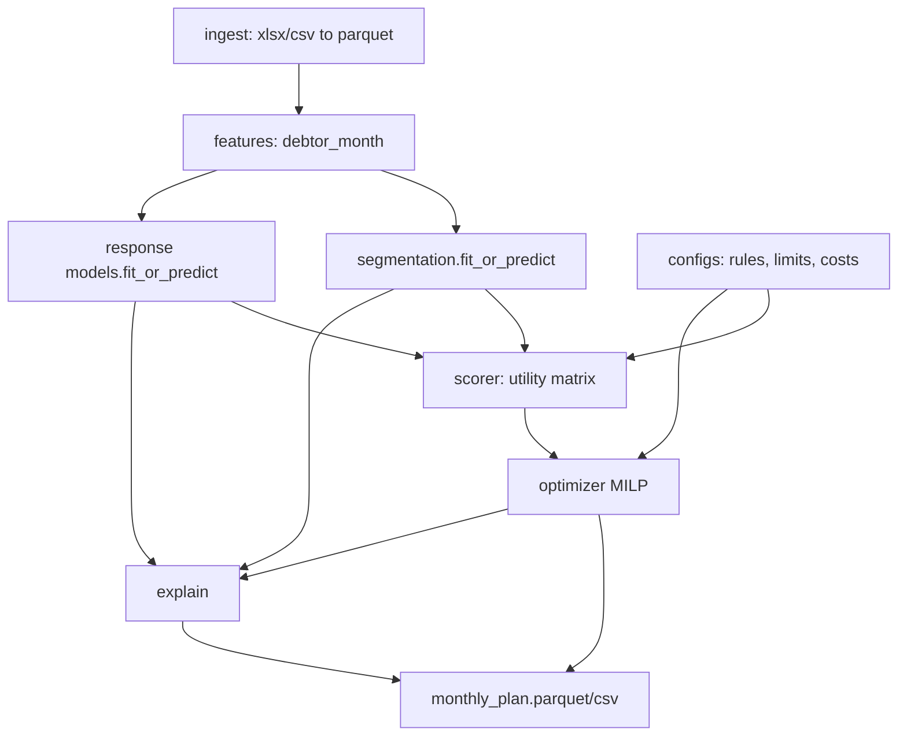

# Стратегия ML-решения: рекомендательная система мер воздействия на должников

Документ описывает архитектурную стратегию (не код) по кейсу ТНС Энерго. Вход — данные из [Материалы к кейсу](Материалы к кейсу): общий справочник ЛС, ОСВ, история оплат и журналы 8 мер воздействия (см. `Readme.docx`, Приложения №1–№2). Выход — месячный план мер по каждому ЛС с учётом лимитов, очередности и объяснений.

Все решения архитектуры подчинены тём инвариантам кейса:

- локальный запуск на стандартном железе (без GPU, без распределённых кластеров);
- жёсткие бизнес-правила (очередность Информирование → Ограничение → Суд; условия из Приложения №1);
- объяснимость на уровне «почему этот клиент в сегменте X и почему ему мера Y».

---

## 1. Декомпозиция задачи

Задача «выдать рекомендации на месяц» нерешаема одной моделью — она сочетает неоднородное поведение (сегментация), причинно-следственный вопрос «что будет, если применить меру» (uplift), и ресурсное распределение под ограничениями (оптимизация). Потому разбиваем её на 5 подзадач:

1. **Сегментация должников** — сжимает пространство поведений в несколько типовых «персон» с устойчивой реакцией на воздействия. Нужна для интерпретируемости, холодного старта (новые ЛС без истории мер) и для агрегированного анализа лимитов.
2. **Прогнозирование отклика на меру (uplift / response)** — для каждой пары (должник, мера) оценка прироста вероятности оплаты и ожидаемой суммы возврата. Без этого шага «рекомендация» не отличается от правила.
3. **Оптимизация набора мер при ограничениях** — превращает «баллы полезности» в реально исполнимый план при лимитах и очередности (целочисленная задача назначения / knapsack).
4. **Учёт бизнес-правил и очередности процедур** — жёсткий фильтр допустимых мер (Приложение №1) и state-машина процедур (Информирование → Ограничение → Суд).
5. **Explainability** — объяснение на двух уровнях: сегмент (почему клиент здесь) и рекомендация (почему эта мера).

**Почему такая декомпозиция:**

- Разделение «предсказания» и «оптимизации» — классический decision-making паттерн (predict-then-optimize). Позволяет независимо тестировать качество моделей (AUC/uplift) и качество плана (лимитные метрики, ROI).
- Сегментация поверх uplift-моделей даёт страховку от разреженности данных по редким мерам (суд, ограничение) и удобный язык для бизнеса.
- Бизнес-правила вынесены в отдельный слой-фильтр, чтобы ML не «изобретал» запрещённые комбинации и чтобы регуляторные изменения не требовали переобучения.

---

## 2. Подход к моделированию

### 2.1 Сегментация

**Методы (в порядке приоритета):**

- Базовая линия — **K-Prototypes / K-Means на стандартизованных признаках** (смешанные числовые + категориальные). Дёшево, интерпретируемо, запускается локально.
- Альтернатива — **GMM / HDBSCAN** для обнаружения нетипичных профилей (например, «разовый забывчивый плательщик» vs «хронический неплательщик»).
- Поверх — **RFM-подобное разложение** (Recency — давность последней оплаты; Frequency — регулярность; Monetary — средняя сумма) как «человеческие» оси, на которых сегменты интерпретируются бизнесом.
- Для поведения во времени — **агрегаты по скользящим окнам** (3/6/12 мес.): доля месяцев с полной оплатой, средняя задержка, тренд ДЗ, «стабильность» интервалов оплат; опционально — простые **shapelet/HMM-фичи** как сжатое описание траектории.

**Почему не deep representation learning:** ограничение на локальный запуск, объём выборки (десятки–сотни тысяч ЛС), и требование объяснимости сегмента делают автоэнкодеры/контрастное обучение избыточными. Выигрыш по качеству не окупит стоимости интерпретации.

**Ключевые признаки:**

- Финансовые: текущая просроченная ДЗ, средний чек, норматив потребления, отношение ДЗ/чек, тренд ДЗ за 3/6/12 мес.
- Платёжная дисциплина: доля оплат «в срок», медианная задержка, volatility оплат, «payment ratio» (оплачено/начислено).
- Контактность: наличие e-mail/телефона, исторический response-rate на СМС/автодозвон/звонок оператора, доля «недозвонов».
- История мер: какие меры применялись, в какой последовательности, время до оплаты после меры.
- Контекст ЛС: тип потребителя (физ/юр), сельский/городской адрес (как прокси — доступность выезда), длительность отношений.

### 2.2 Прогнозирование отклика

**Формулировка target.** Два семейства таргетов — используем оба:

- **Краткосрочный**: `pay_30d` — бинарный признак «оплатил полностью/частично в течение 30 дней после даты решения».
- **Денежный**: `recovered_amount_30/60d` — фактически возвращённая сумма (регрессия или tobit-подобная модель с нулём).

**Наивный классификатор P(pay | measure) недостаточен** — это не каузальный эффект, а смесь «клиент сам бы заплатил» и «помогла мера». Поэтому:

**Uplift / causal inference:**

- **Meta-learners (T-learner, X-learner, R-learner)** поверх XGBoost/LightGBM — оценка `E[Y | T=1, X] − E[Y | T=0, X]` для каждой меры.
- **Causal Forest (EconML)** как более робустная альтернатива при гетерогенных эффектах.
- Если РКТ/A-B отсутствует (вероятно), используем **propensity score + IPW / doubly-robust** поверх исторических данных, с явной проверкой overlap и «позитивности» (каждая мера должна встречаться во всех релевантных подгруппах).
- Для дорогих/редких мер (суд, ограничение) — **policy learning с ограничением на историческую поддержку**: модель не рекомендует меру, если аналогов в данных нет (чтобы не экстраполировать).

**Итоговый «скор полезности» меры m для должника i:**
`utility(i, m) = uplift_prob(i, m) * expected_recovery(i, m) - cost(m) - risk_penalty(i, m)`,
где `cost(m)` — себестоимость меры (СМС ≪ выезд ≪ суд), `risk_penalty` — юридический/репутационный риск (выезд к соцуязвимым, суд при малой ДЗ и т.п.).

### 2.3 Рекомендательная логика

- Для каждой пары (i, m) считаем `utility(i, m)` → получаем матрицу «должник × мера».
- Выбор лучшей меры делается **не жадно**, а совместно с учётом лимитов (см. раздел 3).
- **Последовательность мер:** учитываем явно как state-машину (Информирование → Ограничение → Суд). Не пытаемся учить последовательность end-to-end: данных по длинным цепочкам мало, и правила и так жёсткие. RL-подход здесь создаст больше рисков, чем выгоды.
- **Комбинации мер** (например, СМС + автодозвон в том же месяце) моделируем как **отдельные «действия»** в пространстве действий `A = { подмножества допустимых мер }`, но ограничиваем перебор правилами Приложения №1 (чтобы не взорвать комбинаторику).

**Почему не полноценный RL / contextual bandits на этапе MVP:**

- Нет online-петли с быстрой обратной связью (решения принимаются раз в месяц).
- Исторические данные off-policy, и стабильно обучить policy без propensity-корректировок тяжело.
- Бизнесу нужно объяснение «почему», а RL-policy это даёт плохо.
- **Bandits** уместны на этапе 2: когда система в проде, можно использовать **Thompson sampling с ограничениями** для аккуратного дообучения на новых мерах.

---

## 3. Оптимизация с ограничениями

### 3.1 Формализация

Пусть `x[i, m] ∈ {0,1}` — применять ли меру m к должнику i в этом месяце. Тогда:

- **Цель:** `max Σ utility(i, m) * x[i, m]`.
- **Лимиты (Приложение №2):** `Σ_i x[i, m] ≤ Limit[m]` для каждой меры (СМС 2150, обзвон 1550, выезд 500, претензия 400, автодозвон 8000, уведомление 6200, ограничение 200, суд 400, ИЛ 250).
- **Допустимость (Приложение №1):** `x[i, m] = 0`, если пара (i, m) не удовлетворяет условиям (срок ДЗ, сумма, наличие e-mail/телефона и т.д.).
- **Очередность процедур:** `x[i, Ограничение] ≤ 1[Информирование уже применялось или применяется]`; `x[i, Суд] ≤ 1[Ограничение применено или невозможно]`.
- **Нежелательные пересечения:** опционально, `x[i, СМС] + x[i, Обзвон оператором] ≤ 1` и т.п. (настраивается бизнесом).
- **Справедливость/покрытие:** минимальное воздействие на «горячих» клиентов: `Σ_m x[i, m] ≥ 1` для i c ДЗ выше порога.

### 3.2 Выбор метода

- **Базовый подход — Mixed-Integer Linear Programming (MILP)** через OR-Tools CP-SAT или PuLP+CBC. Задача по размеру (десятки тысяч ЛС × 9 мер) — это ~10^5–10^6 бинарных переменных, но **матрица сильно разрежена** (большинство пар отсеиваются правилами Приложения №1), поэтому CBC/CP-SAT решают её за минуты на обычном ноутбуке.
- **Декомпозиция по мерам** как ускорение: если пересечений между мерами мало, каждая мера — независимый **0/1 knapsack** (бюджет = лимит; «вес» = 1; «ценность» = utility). Решается жадно или DP за секунды.
- **Lagrangian relaxation** при сильной связности ограничений — переводим лимиты в штрафы, ищем двойственные цены `λ_m` (готовый инструмент в OR-Tools).
- **RL/Bandits — только как апгрейд**: когда накопится цикл «рекомендация → наблюдение → переобучение», внедрить **contextual bandit с бюджетными ограничениями (Budgeted Thompson Sampling)** для постепенного исследования новых мер.

**Почему MILP лучше RL для MVP:**

- Гарантии оптимальности и **воспроизводимость** (критично для объяснений бизнесу).
- Бизнес-ограничения выражаются естественно как линейные/логические.
- Локальный запуск: CBC/OR-Tools работают без GPU и внешних сервисов.
- Отсутствует «дрейф политики» — решение детерминировано при фиксированных скорах.

### 3.3 Связка с ML

Используем классический **predict-then-optimize**: ML-модели дают `utility`, оптимизатор даёт план. Чтобы избежать систематического разрыва между «хорошо предсказали» и «плохо решили», добавляем **regret-валидацию** (см. раздел 7): сравниваем наш план с планом, построенным на «истинных» ретроспективных исходах.

---

## 4. Explainability

Два уровня объяснений с конкретными инструментами:

- **Сегмент клиента:**
  - «Человеческое» имя сегмента (например, «Стабильный плательщик с разовой просрочкой», «Хронический неплательщик без контактов»).
  - Центр кластера + top-отличающие признаки (permutation feature importance на задаче «предсказать сегмент»).
  - Для конкретного клиента — расстояние до центров и top-3 признака, «толкнувших» его в сегмент.
- **Рекомендация меры:**
  - **SHAP-значения** для uplift-модели (`shap.TreeExplainer` по XGBoost/LightGBM) — локальное объяснение: «мера Выезд выбрана потому, что ДЗ > 30 тыс., отсутствие результата по ограничению, контактность низкая».
  - **Counterfactuals**: «если бы ДЗ была < 10 тыс., рекомендация сменилась бы с Выезд на СМС+Автодозвон» (DiCE или простые what-if).
  - **Decomposition utility**: отображаем бизнесу компоненты `uplift * recovery − cost − risk` — это сразу объясняет trade-off.
  - **Global policy summary**: таблица «для сегмента X типично рекомендуется набор мер Y» — помогает проверить соответствие здравому смыслу.

Документация объяснений прикрепляется к каждой рекомендации в выходном файле (CSV/Parquet) — чтобы бизнес мог отфильтровать/оспорить.

---

## 5. ML-стек (локальный запуск)

Жёсткое ограничение — локальный ноутбук без GPU. Стек подобран под это.

- **Язык — Python 3.11.** Де-факто стандарт DS, все нужные библиотеки зрелые и pure-CPU.
- **Данные и фичи:**
  - **pandas + pyarrow** — основа; читает xlsx/csv, работает на датасетах до десятков млн строк.
  - **polars** — опционально для тяжёлых джойнов ОСВ/оплат (в 5–10× быстрее pandas на CPU).
  - **DuckDB** — локальный SQL-движок «in-process», идеален для сверки баланса/ОСВ, джойнов с историей мер и feature engineering без внешней БД. Локальный запуск — без сервера.
- **Классические ML-модели:**
  - **scikit-learn** — предобработка, K-Means/K-Prototypes, logistic regression как baseline, pipelines. Прозрачно и воспроизводимо.
  - **LightGBM / XGBoost** — основные модели для response и uplift (через meta-learners). Быстры на CPU, отлично работают с табличными смешанными признаками, дают feature importance.
  - **CatBoost** — альтернатива, сильна на категориальных признаках (тип договора, регион) без ручного кодирования.
- **Uplift / causal:**
  - **EconML** или **CausalML** — meta-learners, Causal Forest, DR-learners. Pure Python, CPU-only.
- **Оптимизация:**
  - **OR-Tools (CP-SAT)** или **PuLP + CBC** — MILP-решатель. Бесплатно, локально, решает задачу нужного масштаба.
- **Explainability:**
  - **SHAP** (TreeExplainer для градиентного бустинга — O(1) по глубине дерева, быстро на CPU).
  - **DiCE** для counterfactuals (опционально).
- **Пайплайны и воспроизводимость:**
  - **Hydra / pydantic-settings** — конфиги (пути к данным, лимиты, пороги). Лимиты из Приложения №2 и правила Приложения №1 — именно конфиг, не код.
  - **DVC** — версионирование данных и моделей без S3 (локально).
  - **MLflow (local file backend)** — трекинг экспериментов, реестр моделей. Без сервера.
  - **Prefect / Make** — простые DAG-и пайплайна. Prefect локально, без облака.
- **Хранение данных:**
  - Сырые — как есть (xlsx/csv).
  - Обработанные — **Parquet** (быстрые колонночные чтения, компрессия ~5×).
  - Feature store — файлы Parquet + метаданные в DuckDB.
- **Интерфейсы:**
  - **CLI (Typer/Click)** — основной интерфейс по ТЗ: команды `ingest`, `train`, `recommend`, `explain`. Соответствует требованию «архив с .py и инструкцией по запуску».
  - **FastAPI (локально, uvicorn)** — опционально, если нужна интерактивная выдача рекомендаций по одному ЛС.
  - **Streamlit** — простой UI для демо/объяснения бизнесу (таблица рекомендаций + SHAP-графики). Не обязателен, но дешёв.
- **Тестирование и качество кода:**
  - **pytest, great_expectations / pandera** — контракты на входные данные (структура xlsx, типы, диапазоны). Критично, т.к. источник — ручные выгрузки.
  - **ruff + mypy** — статический анализ.

**Альтернативы, которые отвергаем и почему:**

- PyTorch/TensorFlow — избыточны, нет GPU, табличные данные.
- Spark/Dask — избыточны для локального запуска; DuckDB закрывает потребность.
- Gurobi/CPLEX — платные; CBC/CP-SAT достаточно.

---

## 6. Архитектура решения

Модули (каждый — отдельный пакет в репозитории, тестируется независимо):

1. `**ingest/`** — загрузка и валидация xlsx/csv, приведение к единой схеме, контроль качества (pandera). Выход: `raw/*.parquet`.
2. `**features/**` — feature engineering: агрегаты оплат, RFM, история мер, фичи контактности, норматив потребления. Выход: `features/debtor_month.parquet` (1 строка = ЛС × месяц).
3. `**segmentation/**` — обучение и применение кластеров; сохраняет модель (joblib) и «карту сегментов» (описание + top-признаки).
4. `**response/**` — обучение классификаторов/регрессий `P(pay | X, T=m)` и uplift-моделей `τ_m(X)`; по одной модели на меру или мульти-target.
5. `**scorer/**` — сборка матрицы utility(i, m) = uplift × recovery − cost − risk; применяет фильтр Приложения №1.
6. `**optimizer/**` — MILP с лимитами Приложения №2 и ограничениями очерёдности; выход: месячный план.
7. `**explain/**` — SHAP и текстовые шаблоны объяснений на русском.
8. `**cli/**` — Typer-команды; `recommend --month 2026-05 --input data/ --output out/`.
9. `**configs/**` — YAML: лимиты, пороги, цены мер, риск-штрафы. Это «ручки» бизнеса.

**Поток данных (happy path):**

Пайплайн **идемпотентен помесячно**: при перезапуске на том же снапшоте даёт тот же план (важно для аудита).

---

## 7. Метрики качества

### 7.1 ML-метрики

- **Для классификатора оплаты**: ROC-AUC, PR-AUC, Brier score (калибровка важна — от калибровки зависит качество оптимизации).
- **Для регрессии возврата**: MAE/RMSE, а также **WMAPE** по сегментам (бизнесу важны крупные ЛС).
- **Для uplift-моделей**: **Qini coefficient, AUUC (Area Under Uplift Curve)**, uplift@k% — показывают, что модель действительно ранжирует по эффекту, а не по базовой склонности платить.
- **Для сегментации**: Silhouette, Davies–Bouldin, стабильность кластеров во времени (ARI между месяцами).

### 7.2 Бизнес-метрики (главные)

- **Ожидаемый возврат ДЗ за месяц** по плану vs. правиловой baseline — ключевая метрика ценности.
- **ROI = (возвращено − стоимость мер) / стоимость мер**; показывает эффективность ресурса.
- **Время до оплаты** (medians) и доля закрытых ЛС в срок.
- **Заполненность лимитов** (utilization) и «утечка» — сколько полезности упущено из-за лимитов; если ограничение СМС «распирает», это сигнал обсудить с бизнесом увеличение лимита.
- **Policy regret** — оффлайн: сравнение с «оракулом» (план, построенный по фактическим исходам) на исторических данных методом **inverse propensity / doubly-robust off-policy evaluation**.
- **Coverage** — доля «горячих» ЛС, получивших хотя бы одно воздействие; не должно быть «забытых».
- **Справедливость/риск**: доля мер Выезд/Суд к клиентам с малой ДЗ (должна быть низкой), доля ошибочно рекомендованных дорогих мер.

### 7.3 Режим валидации

- **Temporal split** (обучение на месяцах t … t-k, валидация на t+1). Случайный split некорректен — есть time leakage.
- **Backtesting политики** на 3–6 последних месяцах с honest off-policy evaluation.
- A/B — в проде: случайная ко-гортa продолжает обслуживаться правилами (baseline), остальные — моделью. Это единственный способ надёжно измерить uplift на практике.

---

## 8. Риски и ограничения

**Данные:**

- **Селективность истории мер**: меры применялись по правилам, а не случайно → сильные confounders. Лечится propensity/DR-корректировками и проверкой overlap. Нужно честно сообщить, что для редких мер (суд, ограничение) каузальные оценки будут широкими.
- **Пропуски и шум** в контактных данных и ОСВ; ручные выгрузки xlsx → риск поломки схемы. Лечится pandera-контрактами и резервными правилами «если нет контактов — только выезд/претензия».
- **Сдвиг распределения (concept drift)** — тарифы, сезонность, макро-шоки. Нужен месячный мониторинг PSI по фичам и AUUC по моделям.

**Модель:**

- **Ошибки калибровки** искажают оптимизатор (он доверяет скорам буквально). Обязательна изотоническая/Platt-калибровка.
- **Оптимизатор может «переэксплуатировать» ошибки модели** в пределах узкой подгруппы. Лечится регуляризацией — мин./макс. долями мер, ограничением на отклонения от baseline, каппингом скорингов.
- **Extrapolation на редкие сегменты** (например, юрлица с крупной ДЗ). Политика: fallback на правила, если нет исторической поддержки.
- **Обратная связь (feedback loop)**: модель, рекомендуя меру, меняет распределение данных, на которых учится следующая версия. Лечится контрольной ко-гортой (exploration) и логированием propensity рекомендаций.

**Бизнес и этика:**

- **Юридические риски** применения суда/ограничения без достаточных оснований → hard-фильтры правил Приложения №1 поверх ML.
- **Репутация**: нельзя рекомендовать Выезд/Суд по мелким суммам; включаем явный `risk_penalty` и нижние пороги.
- **Bias**: проверить, что сегменты не коррелируют с защищаемыми признаками (возраст, район как прокси) — отчёт о справедливости как артефакт каждого обучения.

**Операционные:**

- Локальный запуск ограничивает размер моделей и перебор гиперпараметров — нужен скромный AutoML (Optuna, 20–50 trials) и кэширование.
- Пользователи — бизнес, не DS → важны читаемые конфиги, понятные CLI-команды и текстовые объяснения рекомендаций.

---

## Альтернативы и развилки (краткий итог)

- **Сегментация**: K-Prototypes (выбран, интерпретируем) vs. HDBSCAN (лучше на шуме) vs. автоэнкодеры (избыточны).
- **Предсказание**: чистый классификатор (просто, но не каузально) vs. meta-learners uplift (выбрано) vs. Causal Forest (более робустно, чуть дороже).
- **Оптимизация**: жадный отбор по скору (быстро, но нарушает лимиты) vs. MILP/CP-SAT (выбрано) vs. RL/bandits (потенциал на будущее).
- **Стек**: sklearn+LightGBM+OR-Tools (выбрано, локально) vs. PyTorch+Ray (избыточно) vs. managed ML (нарушает требование локальности).

---

## Что станет артефактами (для последующей реализации)

- `configs/limits.yaml`, `configs/rules.yaml` — из Приложений №1/№2;
- `features/debtor_month.parquet` — фиче-матрица;
- `models/segmentation.joblib`, `models/response_<measure>.joblib`, `models/uplift_<measure>.joblib`;
- `out/recommendations_<YYYY-MM>.csv` — план с колонками `ЛС, меры, scores, explanation`;
- `reports/metrics_<YYYY-MM>.html` — ML + бизнес-метрики + fairness.

Этот документ — проектная основа. На этапе реализации (после подтверждения) пайплайн собирается модульно: ingest → features → segmentation/response → scorer → optimizer → explain, каждый модуль отдельно тестируется и версионируется.